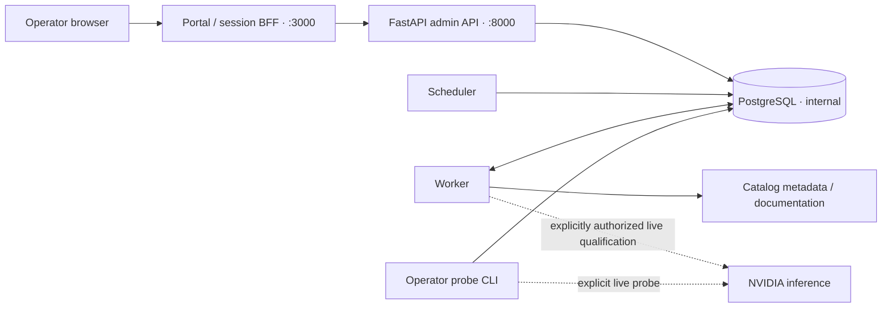

# Agentic Gateway

An LLM gateway project with an implemented operator control plane for catalog discovery, provider evidence, deployment configuration, qualification and pinned-route publication.

**Current scope:** the backend and Portal manage and inspect gateway resources. Public agent inference, agent registration, virtual keys, billing and automatic failover are **not implemented yet**. Publishing an alias does not make it available through a public inference endpoint.

The current source is maintained on [dev](https://github.com/taptanhcoder/agentic-gateway/tree/dev). Package version: **0.1.0**.

## Implemented capabilities

- **Source operations:** durable catalog sync jobs, leases, heartbeats, fencing and opt-in schedules. A failed sync preserves the last published snapshot.
- **Catalog and evidence:** current model offerings, source provenance, field-level evidence and conflict visibility. NVIDIA hosted and SiliconFlow China have catalog/evidence connectors; packaged fixtures support offline development.
- **Deployment targets:** upstream account records, environment-based secret references, immutable deployment generations and revocation epochs.
- **Inference adapter:** a bounded, single-send NVIDIA chat adapter for `meta/llama-3.3-70b-instruct`, invoked through explicit operator probes or qualification. No automatic retry.
- **Qualification:** durable worker runs, per-case observations and versioned text-policy verdicts. Fixture and live observations remain distinct.
- **Publication:** live-verdict gates, compare-and-swap route versions, immutable route snapshots and guarded rollback.
- **Operator Portal:** real PostgreSQL-backed source, model, deployment, qualification, route, job and attempt views; Model Square cards; provider reports; daily charts and resource diagrams.

The Portal also retains navigation for planned features. Unimplemented capabilities show unavailable states rather than simulated operational data. The standalone previews under `demos/` use illustrative data and are separate from the operational Portal.

## Architecture



- **Backend:** Python 3.12, FastAPI, SQLAlchemy, PostgreSQL 16, Alembic and HTTPX.
- **Frontend:** React 19, TypeScript, Vite, Radix/shadcn-style primitives and Lucide icons.
- **BFF:** Node.js 22; the browser uses an eight-hour HttpOnly, SameSite=Strict session. The operator Bearer credential stays on the server after sign-in.
- **Runtime:** Docker Compose. Python dependencies are locked in `uv.lock` and installed as a non-editable package. Frontend dependencies use `frontend/package-lock.json`.

Catalog discovery is not proof of live inference readiness, verified pricing or account quota. Fixture qualification cannot authorize live publication.

## Quick start: Windows / PowerShell

Use **PowerShell 7** and **Docker Desktop with Linux containers**. Docker runs Python, PostgreSQL and the Portal; host Python, uv and Node.js are not required for this workflow.

### 1. Check Docker

```powershell
docker version
docker compose version
docker info --format '{{.OSType}}'
```

The last command must return `linux`.

### 2. Create local configuration

Run from the repository root. This creates random local database and operator credentials without printing them. An existing `.env` is preserved.

```powershell
if (-not (Test-Path -LiteralPath .env)) {
    $gatewayDbPassword = [Convert]::ToHexString([Security.Cryptography.RandomNumberGenerator]::GetBytes(24))
    $gatewayOperatorKey = [Convert]::ToHexString([Security.Cryptography.RandomNumberGenerator]::GetBytes(32))
    $gatewayTemplate = Get-Content -LiteralPath .env.example -Raw
    $gatewayConfig = $gatewayTemplate.Replace('replace-with-a-local-random-password', $gatewayDbPassword).Replace('replace-with-a-local-random-operator-key', $gatewayOperatorKey)
    [IO.File]::WriteAllText((Join-Path $PWD '.env'), $gatewayConfig)
}
```

If `.env` already exists, verify its values before starting. Do not leave either `replace-with-...` placeholder in use. Keep `OPERATOR_API_KEY` separate from provider credentials; there is no built-in default login password.

Important settings in [.env.example](.env.example):

- `POSTGRES_PASSWORD`, `POSTGRES_USER`, `POSTGRES_DB`: database configuration.
- `OPERATOR_API_KEY`: operator login and authenticated admin API access.
- `PORTAL_PORT=3000`, `GATEWAY_PORT=8000`: loopback host ports.
- `PORTAL_COOKIE_SECURE=0`: local HTTP; use `1` when serving the Portal over HTTPS.
- `NVIDIA_API_KEY`: optional upstream inference credential, resolved only when needed.
- `SILICONFLOW_CN_CATALOG_API_KEY`: optional catalog credential.
- `QUALIFICATION_LIVE_MAX_PROBES=0`: live qualification is disabled by default.
- `SCHEDULER_POLL_SECONDS=2`: scheduler polling interval; source schedules remain opt-in.

Changing the database password in `.env` does not rotate the password inside an existing PostgreSQL volume.

### 3. Build and start

```powershell
docker compose up --build -d
docker compose ps -a

curl.exe --max-time 10 -i http://127.0.0.1:8000/health/live
curl.exe --max-time 10 -i http://127.0.0.1:8000/health/ready
```

Default local URLs:

- **Portal:** [http://127.0.0.1:3000](http://127.0.0.1:3000).
- **Model Square:** [open model cards](http://127.0.0.1:3000/?reportSection=models#providers).
- **Provider operations:** [open provider reports](http://127.0.0.1:3000/?reportSection=providers#providers).
- **API / OpenAPI:** [http://127.0.0.1:8000/docs](http://127.0.0.1:8000/docs).

Sign in to the Portal with your configured `OPERATOR_API_KEY`. Restarting the Portal invalidates its in-memory sessions and requires sign-in again.

Both Portal and API ports are bound to `127.0.0.1`. PostgreSQL has no published host port. If a port is occupied, change `PORTAL_PORT` or `GATEWAY_PORT` instead of stopping unrelated services.

A fresh database is migrated through `0006_qualifications` and seeded idempotently. Startup does not automatically sync every source, configure a deployment, qualify a live provider or publish an alias.

### Compose services

- `db`: PostgreSQL, healthcheck and persistent `postgres_data` volume.
- `migrate`: applies Alembic migrations and seed data, then exits with code 0.
- `agentic-gateway-api`: authenticated administration and public health endpoints.
- `agentic-gateway-worker`: processes queued catalog and qualification jobs.
- `agentic-gateway-scheduler`: enqueues due catalog schedules.
- `agentic-gateway-portal`: compiled frontend and session BFF.

Readiness requires database revisions to match the migration heads installed in the API image. `/health/live` is independent of database readiness.

### Logs, upgrades and stopping

```powershell
docker compose logs --tail 50 migrate agentic-gateway-api agentic-gateway-worker agentic-gateway-scheduler agentic-gateway-portal
docker compose run --rm migrate alembic -c /app/alembic.ini current

# Rebuild after source changes; preserve the database volume.
docker compose up --build -d

# Stop services while retaining containers and data.
docker compose stop

# Start the existing stack again.
docker compose up -d

# Remove containers/network, retaining the named database volume.
docker compose down
```

Do not add `--volumes` to development teardown unless you intend to delete the database.

## Operating flow and safety boundaries

1. **Discover:** register supported sources or sync an existing source. Official-source sync may read remote documentation/catalog metadata.
2. **Inspect evidence:** verify exact provider, model, task, region and endpoint associations in current snapshots.
3. **Configure:** create a supported deployment using an account and a secret reference. Provider secret values are not stored in deployment records.
4. **Qualify:** run the text profile against a fixed deployment generation. The Portal exposes **fixture qualification only**; its BFF rejects live qualification.
5. **Publish:** use an eligible, unexpired **live** verdict with the expected route version. Reads and rollback recheck current generation, account, policy and revocation state.
6. **Observe:** inspect jobs, case results, sanitized attempts, provider reports and historical route snapshots.

The current text profile permits at most two probes with up to 16 output tokens per probe. Live qualification additionally requires official evidence, credentials and explicit account/budget configuration. It is not enabled by setting a key alone. See [Qualification](docs/QUALIFICATION.md) before any live run.

Reports aggregate persisted qualification/CLI attempts, **not client API traffic**:

- Provider, mode and UTC time-window filters apply to observations; current inventory remains current inventory.
- Tokens come only from upstream-reported usage. Missing usage is unknown, not measured zero.
- Latency means adapter elapsed time, not time to first token or provider-only latency.
- Pricing, spend, uptime and TPS remain unknown unless the corresponding verified data exists.
- Reading a report does not call a provider.

The Portal is a **single-operator local control plane**, not per-user RBAC. Its BFF uses an allowlist, same-origin JSON writes and bounded requests. Keep `.env` private. Public hosting needs deployment-specific identity, TLS and network configuration.

## API entry points

Public health:

- `GET /health/live`
- `GET /health/ready`

All `/admin/*` endpoints require `Authorization: Bearer <OPERATOR_API_KEY>`:

- **Sources:** `GET/POST /admin/sources`; `POST /admin/sources/{source_id}/sync`; `PUT /admin/sources/{source_id}/schedule`.
- **Evidence:** `GET /admin/offerings`; `GET /admin/offerings/{offering_id}/evidence`.
- **Jobs/history:** `GET /admin/jobs/{job_id}`; `GET /admin/sync-runs/{run_id}`.
- **Deployments:** `POST /admin/portal/deployments`; `PUT /admin/portal/deployment-state/{deployment_id}`.
- **Qualification:** `POST /admin/qualifications`; `GET /admin/qualifications/{run_id}`.
- **Routes:** `POST /admin/pinned-models`; `GET /admin/pinned-models/{model_id}`; `POST /admin/pinned-models/{model_id}/rollback`; `GET /admin/route-snapshots/{snapshot_id}`.
- **Portal reads:** `GET /admin/portal/summary`; paginated `/admin/portal/{deployments|accounts|qualifications|routes|attempts|jobs}`.
- **Reports:** `GET /admin/portal/reports?days=7&mode=all`, optionally filtered by `provider`.

Use OpenAPI for request schemas and the linked module documentation for operational examples. Slash-containing identifiers must be encoded appropriately by the client.

## Portal development and design

The operational frontend lives in `frontend/`. The default model catalog uses cards with a table option; provider operations and detailed reports remain separate.

- Neutral **Light / Dark / System** themes with saved preference.
- Amber `#FFBF00` accents and the original octopus logo.
- Restrained pixel button borders, card hover/focus brackets and actual-loading indicators.
- Reduced-motion support; ordinary tables, forms and report text retain readable typography.
- Unsupported agents, keys, billing and governance screens state their backend limits.

For frontend development, install Node.js 22 and run:

```powershell
cd frontend
npm ci
npm test
npm run build
npm run dev
```

Vite proxies `/portal-api` to the Portal BFF at port 3000; keep the Docker Portal/API running for real data. Use the Local URL printed by Vite. If the BFF uses a different port, update the Vite proxy configuration.

The isolated demos under `demos/portal/` and `demos/portal-v2/` are design references, not alternate production entry points.

## Tests and verification

Backend unit tests, without host Python:

```powershell
docker build --target test -t agentic-gateway:test .
docker run --rm agentic-gateway:test
```

PostgreSQL integration tests:

```powershell
./scripts/test-registry.ps1

# Run a focused suite:
./scripts/test-registry.ps1 -TestPath tests/integration/test_reports.py
```

Integration tests skip without their dedicated database/guard flag. A plain `docker run` test pass does not cover the PostgreSQL suite.

Isolated end-to-end smoke checks, using built runtime/Portal images:

```powershell
docker build --target runtime -t agentic-gateway:dev .
docker compose build agentic-gateway-portal

./scripts/smoke.ps1
./scripts/smoke-catalog.ps1
./scripts/smoke-portal.ps1
```

The scripts create random Compose test projects and disposable databases, preserve the development volume and write results under ignored `reports/runtime/`. The Portal smoke exercises login, BFF/API access, fixture sync through the worker, evidence, report reads and access boundaries. It sends no live provider inference requests.

GitHub Actions:

- [Runtime workflow](.github/workflows/runtime.yml): package/runtime checks, PostgreSQL integration and Compose smoke.
- [Portal workflow](.github/workflows/portal.yml): frontend tests and production build.

**Validation limits:** local frontend/build/HTTP checks do not prove live provider readiness, production scale or a passing remote CI run. A previous broad local PostgreSQL run recorded a failure in `test_heartbeat_keeps_lease_during_slow_page_reads`; its focused rerun also failed. Do not treat the complete backend regression as green until that lease/heartbeat check is resolved and rerun. Use the GitHub Actions run for the exact commit as CI evidence.

## Repository map and detailed documentation

- `src/agentic_gateway/catalog/`: source registry, snapshots, evidence views and durable sync.
- `src/agentic_gateway/providers/`: catalog connectors and inference adapter/deployment services.
- `src/agentic_gateway/qualification/`: policy runs, verdicts and pinned-route gates.
- `src/agentic_gateway/portal/`: bounded operator read models and aggregate reports.
- `src/agentic_gateway/migrations/`: packaged Alembic revisions.
- `frontend/`: operational Portal/BFF; `demos/`: independent design previews.
- `tests/`, `scripts/`: unit/integration tests and isolated smoke runners.

Further reading:

- [Source Registry](docs/SOURCE_REGISTRY.md)
- [Provider Evidence](docs/PROVIDER_EVIDENCE.md)
- [Catalog Operations and Schedules](docs/CATALOG_OPERATIONS.md)
- [Inference Adapter and Operator CLI](docs/INFERENCE_ADAPTER.md)
- [Qualification and Pinned Routes](docs/QUALIFICATION.md)
- [Portal setup, security and reports](docs/PORTAL.md)
- [Pixel effects research and design decisions](docs/PIXEL_EFFECTS.md)

## Git branches

- `dev`: current active development, including the Portal and qualification implementation.
- `develop`: earlier development baseline retained in the repository.
- `main`: stable/release branch; the latest `dev` work is not implicitly released there.

Commit reviewed source and validation evidence to `dev`; promote to the release branch through the repository's review process. Local `.env`, generated reports, caches, build output, node modules and fixture TLS private keys are ignored.
